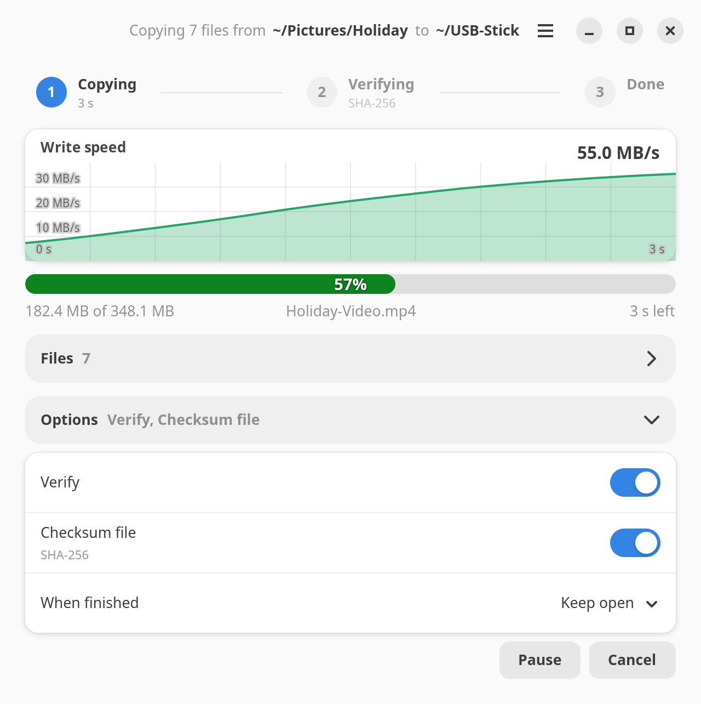

<p align="center">
  
</p>

<h1 align="center">TrustCopy</h1>

<p align="center">
  <b>Copies you can trust.</b> Fast, verified copying and moving from the right-click menu of GNOME Files (Nautilus).<br>
  Every copy is read back from the disk and compared. Installs for your user, no root needed.
</p>

<p align="center">
  <a href="https://github.com/DigitGram/trustcopy/actions/workflows/test.yml"></a>
  <a href="LICENSE"></a>
  <a href="https://github.com/DigitGram/trustcopy/releases/latest"></a>
</p>

<p align="center">
  <a href="#install"><b>Install</b></a> ·
  <a href="#usage">Usage</a> ·
  <a href="#verify-the-download">Verify the download</a> ·
  <a href="https://digitgram.github.io/trustcopy/">Website</a> ·
  <a href="#support">Support</a>
</p>

<p align="center">
  
</p>

Inspired by the Windows tool TeraCopy. Sister project of [HashTally](https://github.com/DigitGram/hashtally).

Normal copying assumes the copy is fine. TrustCopy checks: every file is hashed while it is read, then the
copy is flushed, read back from the disk and compared, so a bad copy is reported instead of discovered
months later.

## Contents

- [What you get](#what-you-get)
- [Requirements](#requirements)
- [Install](#install)
- [Verify the download](#verify-the-download)
- [Usage](#usage)
- [Command line](#command-line)
- [Good to know](#good-to-know)
- [Translating](#translating)
- [Development](#development)
- [How it was made](#how-it-was-made)
- [Support](#support)
- [License](#license)

## What you get

- **Verified copies.** Each copy is read back from the disk and compared; a bad one never replaces your old file and is reported. Choose CRC32 (fast, default) or SHA-256.
- **Safe moves.** A source is deleted only after its own copy has been verified.
- **A live view.** Three steps (Copying, Verifying, Done), a speed graph, time remaining, and a file list with a status per file.
- **No half-written files.** A cancel or a power cut never leaves a damaged file under its real name.
- **A checksum file, if you want one.** Tick *Checksum file* in the window (or switch it on in the settings) and the target folder gets a `SHA256SUMS` (or SHA-512, SHA-1, MD5, SFV) listing every copied file, ready for [HashTally](https://github.com/DigitGram/hashtally) or `sha256sum -c`.
- **Conflicts handled your way.** Ask each time (keep both, skip, overwrite if newer, overwrite), or set a rule. The dialog compares the two files for you (same size and time, newer or older, larger or smaller).
- **Sparse files stay sparse.** A VM disk or a preallocated download keeps its holes on the target, and only its data is read and written.
- **Switch off when done.** In the job window, *When finished* can also suspend or shut down the computer, after a countdown you can cancel.
- **Speed test.** In the settings, *Test* shows which checksum algorithm is fastest on your computer and recommends the fastest secure one.
- **Pause, resume, queue.** Jobs run one after the other; errors are retried, and "Retry failed" repeats only those files.
- **Native look.** GTK 4 and libadwaita, light and dark, in ten languages (English, Deutsch, Español, Français, Italiano, 日本語, Polski, Português (Brasil), Українська, 简体中文).

<p align="center">
  <picture>
    <source media="(prefers-color-scheme: dark)" srcset="docs/screenshots/conflict-dark.png">
    
  </picture>
  <picture>
    <source media="(prefers-color-scheme: dark)" srcset="docs/screenshots/options-dark.png">
    
  </picture>
</p>

<p align="center"><sub>More screenshots on the <a href="https://digitgram.github.io/trustcopy/#gallery">project website</a>.</sub></p>

## Requirements

- A GNOME-family desktop with **Nautilus** (Files), for example Ubuntu 24.04 or newer, Fedora 40 or newer, Debian 13 or newer, Linux Mint 22 or newer. **Nemo** (Cinnamon) and **Caja** (MATE), when installed, get the same Scripts entries.
- Python 3.10+ as the system's `/usr/bin/python3`, GTK 4 + libadwaita >= 1.5 and pycairo for Python
  - Debian/Ubuntu: `sudo apt install python3-gi python3-gi-cairo gir1.2-adw-1`
  - Fedora: `sudo dnf install python3-gobject libadwaita`
  - Arch: `sudo pacman -S python-gobject libadwaita`

Older systems are not supported; the installer stops with an install hint.

## Install

Two ways, pick one. Releases are [signed](#verify-the-download).

| | For | Installs | Needs |
| --- | --- | --- | --- |
| [Install script](#install-script-for-your-user) | any distribution | for your user, `~/.local` | no root |
| [.deb](#debian-ubuntu-linux-mint-the-deb) | Debian, Ubuntu, Linux Mint | for the whole system | `sudo` |

### Install script, for your user

The script needs no root and refuses to run under `sudo`. It downloads exactly the version it belongs to.

Read it first, then run it:

```sh
curl -fsSLO https://github.com/DigitGram/trustcopy/releases/latest/download/install.sh
less install.sh && bash install.sh
```

Or the short way, if you trust the signed release:

```sh
curl -fsSL https://github.com/DigitGram/trustcopy/releases/latest/download/install.sh | bash

# no curl (e.g. a fresh Ubuntu)? wget does the same:
wget -qO- https://github.com/DigitGram/trustcopy/releases/latest/download/install.sh | bash
```

Or from a checkout: `git clone https://github.com/DigitGram/trustcopy && cd trustcopy && ./install.sh`.
Running the one-line installer of a newer release updates an existing installation. The settings can also check for a newer version once a week, if you switch that on; nothing is sent or installed. If the entries do not show up,
restart the file manager (`nautilus -q`, `nemo -q` or `caja -q`); log out and in once if the launcher or icon is missing.

To remove it:

```sh
~/.local/share/trustcopy/install.sh --uninstall   # your settings in ~/.config/trustcopy are kept
~/.local/share/trustcopy/install.sh --purge       # removes the settings too
```

### Debian, Ubuntu, Linux Mint: the .deb

If you would rather not use a terminal: download `trustcopy_<version>_all.deb` from the
[latest release](https://github.com/DigitGram/trustcopy/releases/latest) and open it with a double click (Software or
*Install*), or from a terminal:

```sh
sudo apt install ./trustcopy_<version>_all.deb   # pulls in GTK 4 and libadwaita
```

The package installs for all users, below `/usr`. The right-click entries sit in each user's own home folder, which a
package cannot write to: TrustCopy creates them when you open it for the first time (find it in the Activities overview);
restart the file manager (`nautilus -q`) if it asks. Do not combine it with the install script above: use one of them.

To remove it, run `sudo apt remove trustcopy`. That also deletes the right-click entries of all users (only files
TrustCopy wrote). Your settings in `~/.config/trustcopy` are kept; delete that folder too if you want them gone
(`apt purge` leaves your home folder alone).

### Verify the download

Every release has a file `SHA256SUMS` with the checksums of `install.sh` and the `.deb`, and `SHA256SUMS.asc`, its GPG
signature. The key is the one of `digitgram@proton.me`, fingerprint
`E7AA EB31 A4DE CF99 B314 7E1D FAAB 30B5 FD49 0E93`. Download the files you want into one folder, then:

```sh
curl -fsSL https://github.com/DigitGram.gpg | gpg --import
curl -fsSLO https://github.com/DigitGram/trustcopy/releases/latest/download/SHA256SUMS
curl -fsSLO https://github.com/DigitGram/trustcopy/releases/latest/download/SHA256SUMS.asc
gpg --verify SHA256SUMS.asc SHA256SUMS
sha256sum -c --ignore-missing SHA256SUMS   # --ignore-missing skips the files you did not download
```

Trust the files only if gpg reports a good signature, the fingerprint matches the one above and `sha256sum` says
`OK` for each. `install.sh` names the exact commit it downloads, so this covers the program as well, not just the
installer. (The releases up to 1.3 have a separate `install.sh.asc` instead: `gpg --verify install.sh.asc install.sh`.)

## Usage

Files cannot be taken over: normal Ctrl+C / Ctrl+V still uses Nautilus' own copier. TrustCopy adds entries to the
right-click menu under **Scripts**:

| Where | Entry |
| --- | --- |
| Right-click selected files | **Scripts** > **TrustCopy: Copy to…** / **TrustCopy: Move to…** (asks for the folder) |
| Right-click the folder background | **Scripts** > **TrustCopy: Paste from clipboard** (takes what you copied or cut with Ctrl+C / Ctrl+X) |

On some drives Files does not offer **Scripts** in the background menu (seen on the top folder of an exFAT USB stick).
Use a keyboard shortcut for pasting there, or the separate entry below.

Optional, for **Files (Nautilus) only**: with the `python3-nautilus` package installed (`sudo apt install python3-nautilus`), turn on
*Separate entry in the context menu* in the settings. TrustCopy then has an entry of its own that shows only what fits (*Copy* and *Move* for
a selection, *Paste* for the folder background when you copied files), works beyond 1,500 selected files and can be renamed. Files binds
keys only to scripts, so the keyboard shortcuts do not work while it is on; the *Scripts* entries are removed too. TrustCopy never installs
the package itself.

**Keyboard shortcuts** (Nautilus only, off by default, switched on in the settings): **Ctrl+Alt+C** copy to…,
**Ctrl+Alt+X** move to…, **Ctrl+Alt+V** paste from clipboard. Each key can be changed there; a key that GNOME, Files or
another of your script shortcuts already uses is refused.

Language, checksum, conflict rule, *Reset settings* and *About* are in the settings (open **TrustCopy** from the Activities
overview; while a job runs, right-click its icon > *Settings*, or use the window's menu).

### Command line

From a terminal, `copy` and `move` with `--to` answer there, as text. A file that already exists is asked about in the
terminal (or give `--on-conflict skip|keep_both|newer|overwrite` for scripts). `-q` leaves out the banner and the files that
are fine, `--no-verify` skips the check, `--gui` forces the window.

```sh
trustcopy copy --to /media/maria/USB-Stick ~/Pictures/Holiday   # copy the folder Holiday onto the USB stick, verified
trustcopy move --to ~/Archive big.iso notes.txt                 # move two files; each source goes after its own check
trustcopy copy photo.jpg                                        # no --to: a dialog asks for the destination folder
trustcopy paste --to .                                          # what you copied or cut with Ctrl+C / Ctrl+X, into the current folder
trustcopy settings                                              # open the settings
```

The destination is always the folder after `--to`, and everything else on the line is a source. The folder is copied *into*
the destination: `~/Pictures/Holiday` ends up as `/media/maria/USB-Stick/Holiday`.
Exit code: 0 done, 1 a file failed or the job was cancelled, 2 the command could not run.

### Good to know

- Linux only. Symlinks are copied as links; devices, sockets and pipes are not copied (listed as failed).
- Ownership is not preserved (like plain `cp`); permissions, times and xattrs are.
- After a hard stop (crash, power cut) a `name.trustpart` can be left behind. After the next copy into that folder the window offers to delete such leftovers, and `trustcopy clean FOLDER` does it from a terminal (it lists them first and asks; `--yes` skips the question).
- Read-back verification cannot catch a cheap USB stick whose controller confirms a flush it has not done. For a copy that must
  not fail there: eject, plug it in again and check it with a hash file ([HashTally](https://github.com/DigitGram/hashtally)).

How verification, the speed graph and the file list work, and the full list of limits: [docs/details.md](docs/details.md).

## Translating

Translations are plain gettext `.po` files in `po/`, read directly at runtime. German is maintained by the author.
All other translations were generated by an AI assistant and have not been reviewed by native speakers;
corrections are welcome as pull requests. How to add a language: [docs/development.md](docs/development.md#translating).

## Development

Project layout, how it works, running the tests and trying every dialog by hand: [docs/development.md](docs/development.md).

## How it was made

TrustCopy is developed and maintained by DigitGram. The project is shaped by its requirements, design decisions and ongoing development.

AI-assisted tools were used during implementation and to support code quality improvements, testing, hardening and translations. All changes are reviewed and tested by the author, who is responsible for the final result.

The code is open, the test suite is available in `tests/`, and issues and pull requests are welcome.

## Support

TrustCopy is free and stays free. If it is useful to you, you can support its development on [GitHub Sponsors](https://github.com/sponsors/DigitGram) or [Liberapay](https://liberapay.com/DigitGram). Donations are voluntary and unlock nothing.

## License

Copyright (C) 2026 DigitGram. TrustCopy is free software: you can redistribute it and/or modify it
under the terms of the [GNU General Public License](LICENSE) as published by the Free Software
Foundation, either version 3 of the License, or (at your option) any later version. It comes without
any warranty. The icon is part of the project and under the same license.
